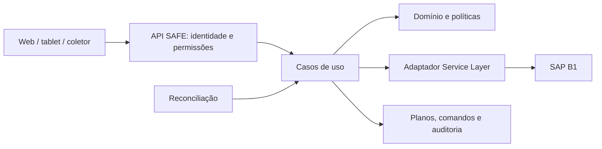

# 03 — Arquitetura e modularidade

Estado: proposta; não existe implementação. Preferir monólito modular com backend intermediário, conforme [ADR-002](decisions/0002-monolito-modular-e-adaptador-sap.md). Stack, hospedagem e banco dependem de decisão registrada; não introduzir microserviços ou infraestrutura apenas para distribuir arquivos.

## Fronteiras

| Módulo | Responsabilidade | Não deve fazer |
|---|---|---|
| Identidade/autorização | Usuário, empresa, papéis, depósitos e escopo | Confiar na empresa enviada pelo navegador |
| Demanda | Documento/linha elegível e referência SAP | Misturar linhas só por ItemCode |
| Disponibilidade | Consulta normalizada, proveniência e frescor | Fabricar saldo de lote a partir de agregado |
| Planejamento | Intenção manual, validações e revisão | Reservar estoque SAP implicitamente |
| Liberação | Orquestrar lista e alocação | Declarar sucesso antes da verificação |
| Execução | Quantidade física, divergências, confirmação | Gerar documento logístico automaticamente |
| Integração SAP | Sessão, OData, contratos e mapeamentos | Conter decisões de UX ou permissão local |
| Auditoria/reconciliação | Eventos, tentativas, consultas de recuperação | Repetir escrita desconhecida cegamente |
| Interface | Apresentar medidas/estado e captar escolha | Ser autoridade de regra de saldo |

Dependências: interface → aplicação → domínio; infraestrutura implementa portas definidas internamente. Domínio não importa SDK SAP, cliente HTTP, framework web ou persistência. DTOs SAP ficam no adaptador. Casos de uso pequenos; proibir controlador único que consulte SAP, calcule saldo, grave plano e confirme tudo sem fronteiras testáveis.

## Modelo local proposto

| Entidade | Campos conceituais mínimos |
|---|---|
| Plano | ID, empresa, autor, revisão, estado local, datas |
| Linha de demanda | Tipo/DocEntry/linha-base, item, depósito-base, unidade, quantidade pretendida |
| Origem planejada | Linha local, depósito elegível, identidade/número de lote, quantidade, bin se aplicável |
| Snapshot | Fonte, instante, revisão/assinatura, medidas com unidade, limitações |
| Vínculo SAP | Empresa, ID Pick List, linha SAP, referência de demanda, estado remoto observado |
| Comando | ID, chave idempotente, tipo, hash canônico, revisão esperada, status, tentativas e resultado |
| Evento de auditoria | Ator, ação, motivo, antes/depois mínimo, comando, horário UTC, correlação |

Snapshots são observações; não constituem livro de estoque. Banco local não deve ser usado para afirmar saldo atual. Guardar apenas dados necessários, com retenção aprovada. Constraint de unicidade de comando por empresa/chave e controle otimista de revisão do plano devem existir na futura implementação.

## Contratos internos propostos

Os nomes abaixo são semânticos, não endpoints SAP nem APIs já disponíveis:

- `ConsultarDemandas(filtros, escopo)` → linhas elegíveis e limitações.
- `ConsultarOrigens(referenciaLinha)` → ofertas por depósito/lote, medidas e timestamp.
- `SalvarPlano(plano, revisaoEsperada)` → nova revisão local.
- `LiberarPlano(id, revisaoEsperada, chaveIdempotencia)` → ID de comando e estado observável.
- `RegistrarSeparacao(id, origensReais, motivo, revisaoEsperada)` → revisão local.
- `ConfirmarSeparacao(id, revisaoEsperada, chaveIdempotencia)` → ID de comando.
- `ConsultarComando(id)` e `ReconciliarComando(id)` → evidências e resultado.

Resposta de escrita deve distinguir aceito/em execução de confirmado no SAP. O backend calcula escopo a partir da sessão e valida todos os IDs. Quantidades devem ter representação decimal explícita; datas de auditoria em UTC e apresentação no fuso definido para o cliente.

## Persistência e execução

Persistir comando antes da chamada remota. Um worker pode executá-lo e reconciliá-lo, com recuperação após reinício. Transação local agrupa intenção/estado/auditoria, mas não inclui automaticamente o SAP. Usar outbox ou mecanismo equivalente quando houver fila; não prometer entrega exatamente uma vez entre sistemas. Detalhar em ADR antes de implementar.

Cache de leitura deve ter prazo configurável, identidade de empresa e origem; invalidar após escrita. Liberação/confirmação não usam cache como prova suficiente. Expor métricas de latência, falhas por categoria, comandos desconhecidos e idade de reconciliação; sem IDs sensíveis como labels de alta cardinalidade.
